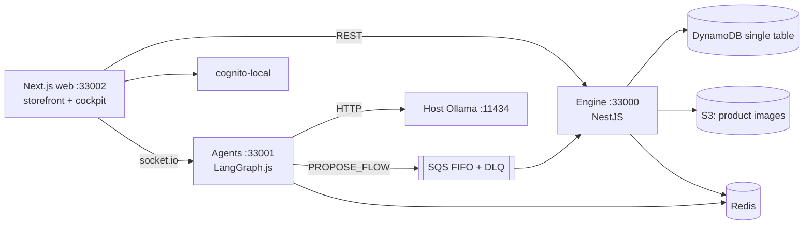

# 🛍️ Marketplace

> A multi-tenant shop for makers who also teach: one catalogue of products and bookable events, set up by talking to it.

**A NestJS engine on a DynamoDB single table, a LangGraph agents service that proposes schema changes and drafts shop content but never applies them, and a Next.js app that is both the public storefront and the seller's cockpit. Tenant isolation, no-oversell stock and capacity, and idempotent checkout are asserted end to end against the full Docker stack.**

<!-- readme-header -->
[](https://github.com/sathwikbairaboina2/marketplace/actions/workflows/ci.yml)      

## What it does

- **Products and bookings in one store.** Products with stock, events with capacity, one cart, one order queue. A pottery studio can sell mugs and run classes without two apps.
- **A schema that talks back.** Each tenant has a schema registry per entity type, and every write validates tenant-defined `attributes` against it. Forms, search filters and detail rows in the web app are generated from `GET /schemas`. A chat with the agents service produces a validated schema-change proposal; confirming it queues a `PROPOSE_FLOW` message and the engine records a Flow at `status: 'proposed'`. Only a human calling `POST /flows/:id/execute` changes the registry. Changes are add-only, because there is no backfill.
- **Storefront.** Public shop hosts (`<tenant>.localhost`) with products, events, cart, checkout, order tracking, `robots.txt`, `sitemap.xml` and per-page metadata. Guest checkout uses an HMAC-signed, tenant-bound ticket with order lookup by id plus email.
- **Payments.** Behind a `PAYMENT_PROVIDER` seam: a fake card provider and a local UPI provider by default, and a Razorpay provider when `RAZORPAY_KEY_ID` and `RAZORPAY_KEY_SECRET` are set.
- **Order stages.** Owner-defined stages on an order, visible to the buyer.
- **Seller cockpit.** `/admin/*` covers dashboard, products, events, orders, bookings, flows, settings, onboarding, an outbox and a chat with the agents.
- **Agents.** LangGraph.js with a Redis checkpointer: schema-change drafting, an onboarding interview that infers needs and proposes a theme, a copywriter, and an order-support assistant.
- **Money and errors.** Money is integer minor units plus an ISO-4217 currency, never floats. Every error is an RFC 9457 problem document.

## Architecture



The engine and agents are decoupled by the FIFO queue; agents own no database. The tenant comes only from the `custom:tenant_id` claim on the ID token, and `DynamoRepository` is the only code that builds a partition key, so a cross-tenant query cannot be written. Cross-tenant reads return 404, never 403. Concurrency for stock and capacity uses DynamoDB condition expressions inside `TransactWriteItems`. The queue consumer is a second entry point for a tenant id with no JWT behind it, so it re-validates the id, leaves bad messages unacknowledged so redrive (`maxReceiveCount: 5`) moves them to the DLQ, and deduplicates redelivery per `messageId` in Redis.

## Quickstart

Needs Node 22+, pnpm 9, Docker, and an Ollama daemon on the host with `qwen3.8:27b` (GPU recommended). The stack runs no Ollama of its own; `ollama-init` is only a gate that pulls the model on the host daemon and fails fast if it is down. Override with `OLLAMA_BASE_URL` and `LLM_MODEL`.

```bash
pnpm install
pnpm docker:up      # data plane, seed, then engine, agents, web
pnpm test           # unit + integration
pnpm e2e            # engine, agents, then web suites, then tears down
pnpm docker:down    # stop and drop volumes
```

`pnpm docker:up` seeds the DynamoDB table, FIFO queue and DLQ, a Cognito pool, four demo tenants (a seller and a buyer each), their catalogues and photos, and writes generated ids to `docker/.env.generated`. Sign in at <http://localhost:33002> with a seeded persona (see `docker/seed`). Swagger UI is at `http://localhost:33000/api/v1/docs` (engine) and `http://localhost:33001/api/v1/docs` (agents), enabled only when `DOCS_ENABLED=true` with a Cognito endpoint, which is only true in the compose file.

Every host port is the service default plus 30000; inside the compose network the defaults apply.

| Port | Service |
| --- | --- |
| 33000 | engine |
| 33001 | agents |
| 33002 | web |
| 34566 | localstack (SQS, S3) |
| 36379 | redis |
| 38000 | dynamodb-local |
| 39229 | cognito-local |

Per package: `pnpm --filter @marketplace/engine test:e2e` (engine suites against a running stack), `pnpm --filter @marketplace/web e2e:journeys` (browser journeys), `pnpm --filter @marketplace/web ui:campaign`. Run the whole repo with `npx turbo run test --concurrency=1`; parallel runs have produced unrelated red suites. `npx turbo run typecheck --concurrency=1` is what CI runs.

## Invariants

Asserted end to end against the Docker stack, not only unit tested:

1. **Tenant isolation.** Another tenant's resource by exact id returns 404.
2. **No oversell of capacity.** Concurrent bookings never exceed event capacity; losers get 409.
3. **No oversell of stock.** The same for concurrent orders.
4. **Idempotency.** `POST /orders` and `POST /bookings` require an `Idempotency-Key`; the same key twice yields one order or booking. A repeat while the first is in flight returns `409 request-in-progress`. Keys are scoped per tenant and user.
5. **Flow lifecycle.** A proposed Flow never mutates the registry until executed, and executing twice does not bump the version twice.

Role selects navigation in the web app and is not an authorization boundary: the engine enforces tenant isolation on every route, and role checks only on admin-only routes.

## Project layout

```
apps/engine          NestJS: auth, products, events, orders, bookings, cart, checkout, payments, flows, registry, storefront, SQS consumer
apps/agents          NestJS: WebSocket gateway, LangGraph graphs, copywriter, support
apps/web             Next.js: (shop) storefront and (admin) cockpit
packages/contracts   Zod schemas, the single source of truth for entity shapes
packages/auth        shared JWT verifier and tenant context
packages/openapi     OpenAPI document support
docker/              Compose stack and seed
docs/                STATUS, ROADMAP, DECISIONS, backlog, specs and plans under docs/superpowers
```

Start with `docs/STATUS.md` for what was last verified, `docs/DECISIONS.md` for product calls, and `CLAUDE.md` for the traps this machine springs (IPv6 loopback stalls, parallel test runs).

## Status

Private working prototype, past the original engine and agents specs: cart, checkout, guest checkout, UPI, SEO and order stages are built. `docs/ROADMAP.md` is a proposal and nothing in it is built unless `docs/STATUS.md` says so. Razorpay is wired but needs real credentials to exercise. CI runs typecheck, unit tests and the engine end-to-end suite on a runner; the agents and web suites need the shared model and run locally. The last recorded CI run (a manual dispatch on 3 September 2026) passed. No LICENSE file.
